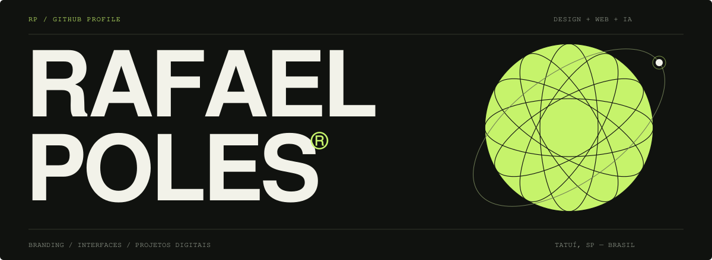
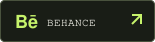
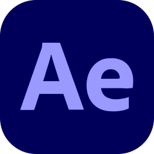
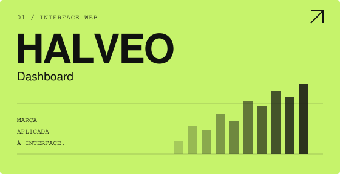
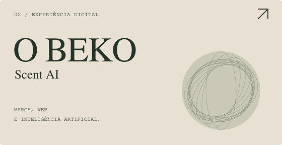
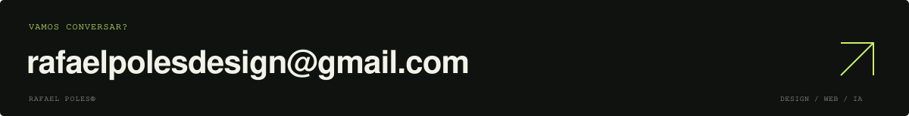

<!-- Rafael Poles® · README de perfil / rpoless -->

  

  
  &nbsp;
  
  &nbsp;
  

 

## `01` Sobre

<table>
  <tr>
    <td width="65%" valign="top">
      <h3>Trabalho com design e criação de sites.</h3>
      
Sou <strong>Rafael Poles®</strong>. Desenvolvo marcas, sites e interfaces, da identidade visual à implementação na web.

      
Uso IA para pesquisar, explorar ideias, programar e documentar projetos. Por aqui, compartilho aplicações, experimentos e o que estou construindo.

    </td>
    <td width="35%" valign="top">
      
<strong>Ruptive®</strong> Atuação independente desde 2022.

      
<strong>Multimídia · SENAI</strong> Conclusão prevista em 2026.

      
<strong>Tatuí, SP · Brasil</strong> Português nativo. Inglês intermediário.

    </td>
  </tr>
</table>

 

## `02` Ferramentas

<table>
  <tr>
    <td width="30%" valign="top">
      <h4>Web</h4>
      

        
        
      

      
<strong>HTML · CSS</strong> Implementação de sites e interfaces.

    </td>
    <td width="40%" valign="top">
      <h4>Em desenvolvimento</h4>
      

        
        
        
      

      
<strong>JavaScript · React · Node.js</strong> JavaScript básico; projetos com React e Node.js com assistência de IA.

    </td>
    <td width="30%" valign="top">
      <h4>Ambiente</h4>
      

      
<strong>Visual Studio Code</strong> Criação, edição e organização dos projetos.

    </td>
  </tr>
</table>

### IA no processo

  
  &nbsp;
  
  &nbsp;
  

**ChatGPT e Codex** no apoio à pesquisa, criação e desenvolvimento. **Claude** nos estudos de IA e programação assistida.

### Design e audiovisual

  
  &nbsp;
  
  &nbsp;
  
  &nbsp;
  

**Illustrator · Photoshop · After Effects · Premiere Pro** 
Também trabalho com Lightroom e InDesign. Minha experiência inclui branding, identidade visual e verbal, materiais gráficos, vídeo e motion design.

 

## `03` Projetos

<table>
  <tr>
    <td width="50%" valign="top">
      
      <h3>Halveo Dashboard</h3>
      
Dashboard que leva a identidade da Halveo para uma interface web. Projeto de marca, aplicação digital e documentação para portfólio.

      
<code>Dashboard</code> <code>Interface web</code> <code>Branding</code>

      
<a href="https://github.com/rpoless/halveo-dashboard"><strong>Explorar projeto ↗</strong></a>

    </td>
    <td width="50%" valign="top">
      
      <h3>O BEKO · Scent AI</h3>
      
Projeto web no universo da perfumaria, explorando a relação entre identidade de marca, experiência digital e inteligência artificial.

      
<code>Web design</code> <code>IA</code> <code>Experiência digital</code>

      
<a href="https://github.com/rpoless/site-ia-obeko"><strong>Explorar projeto ↗</strong></a>

    </td>
  </tr>
</table>

<a href="https://github.com/rpoless?tab=repositories">Todos os repositórios ↗</a>

 

## `04` Formação

**Técnico em Multimídia · SENAI Luiz Pagliato** 
Sorocaba, SP · conclusão prevista em 2026 · parceria com o SESI em Tatuí.

  
<strong>IA, desenvolvimento e outras formações ↓</strong>

   

| Instituição | Cursos e estudos |
| :--- | :--- |
| **Claude Academy** | AI Fluency · Claude Code 101 · Claude 101 |
| **OpenAI** | Agents and Workflows · AI Foundations |
| **SENAI** | Fundamentos da Inteligência Artificial · Marketing Digital com Inteligência Artificial · Microsoft Power BI |
| **Overlens** | IA Lab |
| **Design** | ID Class · Introdução ao design de logos · Design do universo gráfico de uma marca |

 

<!-- Ícones: Skill Icons e Lobe Icons, sob licença MIT. Atribuições em assets/licenses/. -->
