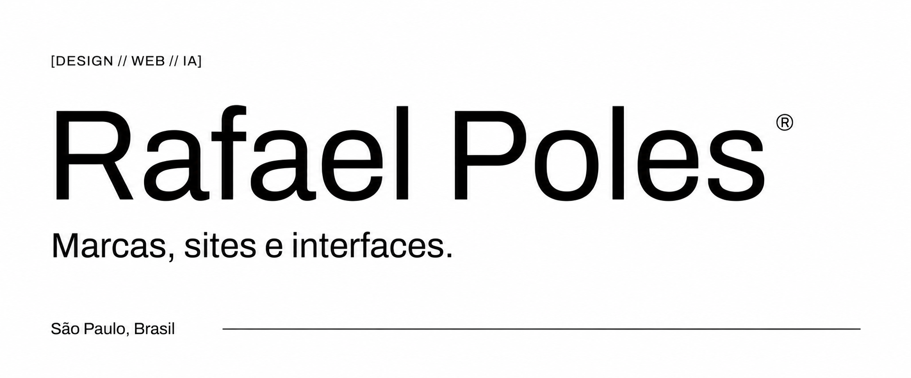

<!-- Rafael Poles · README híbrido: conteúdo nativo e elementos gráficos monocromáticos -->

<picture>
  <source media="(prefers-color-scheme: dark)" srcset="./assets/header-dark.png">
  <source media="(prefers-color-scheme: light)" srcset="./assets/header-light.png">
  
</picture>

<a href="https://rpoles12.github.io/site-ruptive/">
<picture>
  <source media="(prefers-color-scheme: dark)" srcset="./assets/dark/button-ruptive.svg">
  <source media="(prefers-color-scheme: light)" srcset="./assets/light/button-ruptive.svg">
  
</picture>
</a>
&ensp;
<a href="https://www.linkedin.com/in/rafael-poles-bb69a1251/">
<picture>
  <source media="(prefers-color-scheme: dark)" srcset="./assets/dark/button-linkedin.svg">
  <source media="(prefers-color-scheme: light)" srcset="./assets/light/button-linkedin.svg">
  
</picture>
</a>
&ensp;
<a href="https://www.behance.net/rafaeldesign1">
<picture>
  <source media="(prefers-color-scheme: dark)" srcset="./assets/dark/button-behance.svg">
  <source media="(prefers-color-scheme: light)" srcset="./assets/light/button-behance.svg">
  
</picture>
</a>
&ensp;
<a href="mailto:rafaelpolesdesign@gmail.com">
<picture>
  <source media="(prefers-color-scheme: dark)" srcset="./assets/dark/button-email.svg">
  <source media="(prefers-color-scheme: light)" srcset="./assets/light/button-email.svg">
  
</picture>
</a>

 

## [01] Sobre

Sou Rafael Poles. Desenvolvo marcas, sites e interfaces. Uso IA na pesquisa, na prototipação e no desenvolvimento de projetos digitais.

Aqui reúno aplicações, experimentos e projetos que conectam design e tecnologia.

 

## [02] Ferramentas

### Web e desenvolvimento

<picture>
  <source media="(prefers-color-scheme: dark)" srcset="./assets/dark/icons/html.svg">
  <source media="(prefers-color-scheme: light)" srcset="./assets/light/icons/html.svg">
  
</picture>
&ensp;
<picture>
  <source media="(prefers-color-scheme: dark)" srcset="./assets/dark/icons/css.svg">
  <source media="(prefers-color-scheme: light)" srcset="./assets/light/icons/css.svg">
  
</picture>
&ensp;
<picture>
  <source media="(prefers-color-scheme: dark)" srcset="./assets/dark/icons/javascript.svg">
  <source media="(prefers-color-scheme: light)" srcset="./assets/light/icons/javascript.svg">
  
</picture>
&ensp;
<picture>
  <source media="(prefers-color-scheme: dark)" srcset="./assets/dark/icons/react.svg">
  <source media="(prefers-color-scheme: light)" srcset="./assets/light/icons/react.svg">
  
</picture>
&ensp;
<picture>
  <source media="(prefers-color-scheme: dark)" srcset="./assets/dark/icons/nodejs.svg">
  <source media="(prefers-color-scheme: light)" srcset="./assets/light/icons/nodejs.svg">
  
</picture>

HTML · CSS · JavaScript · React · Node.js

Do layout à implementação, com apoio de IA na prototipação e no desenvolvimento.

### Ambiente

<picture>
  <source media="(prefers-color-scheme: dark)" srcset="./assets/dark/icons/vscode.svg">
  <source media="(prefers-color-scheme: light)" srcset="./assets/light/icons/vscode.svg">
  
</picture>
&ensp;
<picture>
  <source media="(prefers-color-scheme: dark)" srcset="./assets/dark/icons/github.svg">
  <source media="(prefers-color-scheme: light)" srcset="./assets/light/icons/github.svg">
  
</picture>

Visual Studio Code · GitHub

Código, organização e documentação dos projetos.

### Inteligência artificial

<picture>
  <source media="(prefers-color-scheme: dark)" srcset="./assets/dark/ai-chatgpt.svg">
  <source media="(prefers-color-scheme: light)" srcset="./assets/light/ai-chatgpt.svg">
  
</picture>
&ensp;
<picture>
  <source media="(prefers-color-scheme: dark)" srcset="./assets/dark/ai-codex.svg">
  <source media="(prefers-color-scheme: light)" srcset="./assets/light/ai-codex.svg">
  
</picture>
&ensp;
<picture>
  <source media="(prefers-color-scheme: dark)" srcset="./assets/dark/ai-claude.svg">
  <source media="(prefers-color-scheme: light)" srcset="./assets/light/ai-claude.svg">
  
</picture>

ChatGPT · Codex · Claude

Pesquisa, exploração de ideias, prototipação, apoio ao desenvolvimento e documentação.

### Design e audiovisual

<picture>
  <source media="(prefers-color-scheme: dark)" srcset="./assets/dark/icons/illustrator.svg">
  <source media="(prefers-color-scheme: light)" srcset="./assets/light/icons/illustrator.svg">
  
</picture>
&ensp;
<picture>
  <source media="(prefers-color-scheme: dark)" srcset="./assets/dark/icons/photoshop.svg">
  <source media="(prefers-color-scheme: light)" srcset="./assets/light/icons/photoshop.svg">
  
</picture>
&ensp;
<picture>
  <source media="(prefers-color-scheme: dark)" srcset="./assets/dark/icons/indesign.svg">
  <source media="(prefers-color-scheme: light)" srcset="./assets/light/icons/indesign.svg">
  
</picture>
&ensp;
<picture>
  <source media="(prefers-color-scheme: dark)" srcset="./assets/dark/icons/lightroom.svg">
  <source media="(prefers-color-scheme: light)" srcset="./assets/light/icons/lightroom.svg">
  
</picture>
&ensp;
<picture>
  <source media="(prefers-color-scheme: dark)" srcset="./assets/dark/icons/after-effects.svg">
  <source media="(prefers-color-scheme: light)" srcset="./assets/light/icons/after-effects.svg">
  
</picture>
&ensp;
<picture>
  <source media="(prefers-color-scheme: dark)" srcset="./assets/dark/icons/premiere.svg">
  <source media="(prefers-color-scheme: light)" srcset="./assets/light/icons/premiere.svg">
  
</picture>
&ensp;
<picture>
  <source media="(prefers-color-scheme: dark)" srcset="./assets/dark/icons/media-encoder.svg">
  <source media="(prefers-color-scheme: light)" srcset="./assets/light/icons/media-encoder.svg">
  
</picture>

Illustrator · Photoshop · InDesign · Lightroom · After Effects · Premiere Pro · Media Encoder

Identidade visual, interfaces, materiais gráficos, fotografia, vídeo e motion design.

 

## [03] Projetos selecionados

<table>
  <tr>
    <td width="50%" valign="top">
      <h3>Halveo Dashboard</h3>
      
Protótipo de dashboard para monitorar recursos industriais, investigar desvios e acompanhar ações. Integra identidade de marca e interface do produto.

      
Interface web · Branding

      
<a href="https://github.com/rpoles12/halveo-dashboard">Explorar projeto ↗</a>

    </td>
    <td width="50%" valign="top">
      <h3>O BEKO · Scent AI</h3>
      
Catálogo de perfumes com consultoria conversacional para descobrir fragrâncias a partir de preferências e perfil.

      
Web design · Interface

      
<a href="https://github.com/rpoles12/site-ia-obeko">Explorar projeto ↗</a>

    </td>
  </tr>
  <tr>
    <td width="50%" valign="top">
      <h3>VIG.IA OS</h3>
      
Escape room com documentos, pistas e uma assistente narrativa em um sistema operacional fictício. A investigação avança por etapas.

      
Experiência interativa · JavaScript · Narrativa

      
<a href="https://github.com/rpoles12/vig.ia-os">Explorar projeto ↗</a> · <a href="https://vigia-os-escape-room.vercel.app">Abrir experiência ↗</a>

    </td>
    <td width="50%" valign="top">
      <h3>Pilates da Márcia</h3>
      
Aplicação para organizar aulas de Pilates, registrar treinos e acompanhar calendário e progresso. Pensada para o celular e para a constância.

      
Mobile first · JavaScript · Design de produto

      
<a href="https://github.com/rpoles12/pilates-marcia">Explorar projeto ↗</a> · <a href="https://pilates-marcia.vercel.app">Abrir aplicação ↗</a>

    </td>
  </tr>
</table>

<a href="https://vigia-os-escape-room.vercel.app">
<picture>
  <source media="(prefers-color-scheme: dark)" srcset="./assets/dark/button-demo-vigia.svg">
  <source media="(prefers-color-scheme: light)" srcset="./assets/light/button-demo-vigia.svg">
  
</picture>
</a>
&ensp;
<a href="https://pilates-marcia.vercel.app">
<picture>
  <source media="(prefers-color-scheme: dark)" srcset="./assets/dark/button-demo-pilates.svg">
  <source media="(prefers-color-scheme: light)" srcset="./assets/light/button-demo-pilates.svg">
  
</picture>
</a>

<a href="https://github.com/rpoles12?tab=repositories">
<picture>
  <source media="(prefers-color-scheme: dark)" srcset="./assets/dark/button-repositories.svg">
  <source media="(prefers-color-scheme: light)" srcset="./assets/light/button-repositories.svg">
  
</picture>
</a>

 

## Contato

Vamos conversar.

[rafaelpolesdesign@gmail.com](mailto:rafaelpolesdesign@gmail.com)

[Ruptive](https://rpoles12.github.io/site-ruptive/) · [LinkedIn](https://www.linkedin.com/in/rafael-poles-bb69a1251/) · [Behance](https://www.behance.net/rafaeldesign1)

<!-- Capas, ícones e botões reutilizam os assets existentes. O conteúdo principal permanece em Markdown/HTML nativo; a fonte dos textos segue o tema do GitHub. -->
