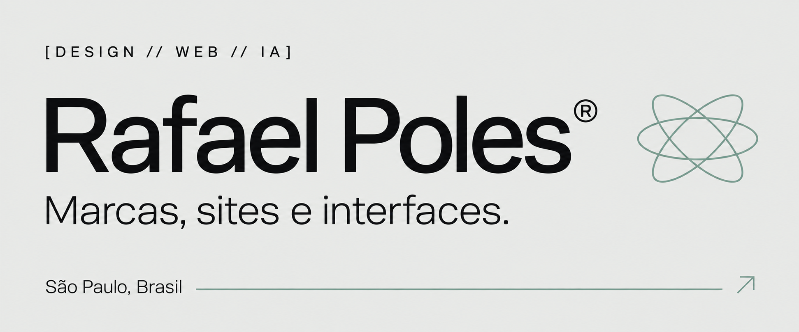
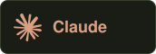
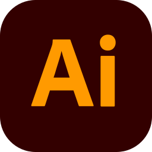
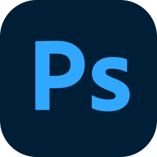
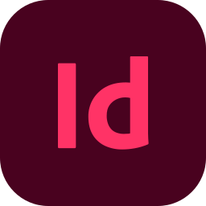
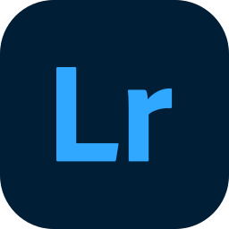
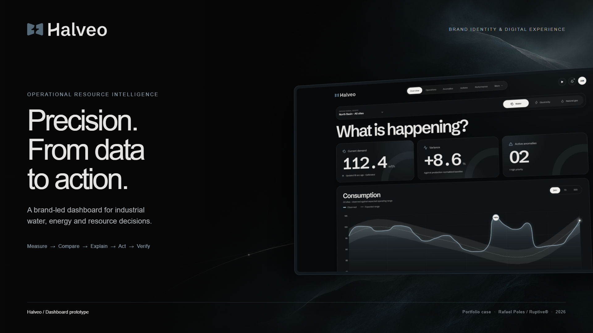
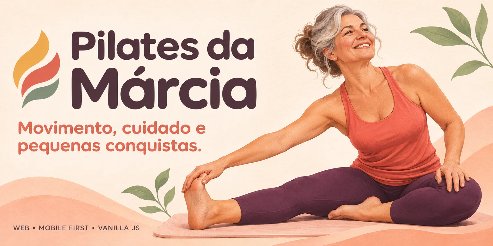

<!-- Rafael Poles · README de perfil / rpoles12 -->

  

  
  &nbsp;
  
  &nbsp;
  
  &nbsp;
  

 

## [01] Sobre

Desenvolvo marcas, sites e interfaces. Uso IA na pesquisa, na prototipação e no desenvolvimento de projetos digitais.

Aqui reúno aplicações, experimentos e projetos que conectam design e tecnologia.

 

## [02] Tecnologias e ferramentas

<table>
  <tr>
    <td width="70%" valign="top">
      <h3>Web</h3>
      

        
        &nbsp;
        
        &nbsp;
        
        &nbsp;
        
        &nbsp;
        
      

      
<strong>HTML · CSS · JavaScript · React · Node.js</strong>

      
Do layout à implementação, com apoio de IA na prototipação e no desenvolvimento.

    </td>
    <td width="30%" valign="top">
      <h3>Ambiente</h3>
      

        
        &nbsp;
        
      

      
<strong>VS Code · GitHub</strong>

      
Código, organização e documentação dos projetos.

    </td>
  </tr>
</table>

### Inteligência artificial

  
  &nbsp;
  
  &nbsp;
  

Pesquisa, exploração de ideias, prototipação, apoio ao desenvolvimento e documentação.

### Design e audiovisual

  
  &nbsp;
  
  &nbsp;
  
  &nbsp;
  
  &nbsp;
  
  &nbsp;
  
  &nbsp;
  

**Illustrator · Photoshop · InDesign · Lightroom · After Effects · Premiere Pro · Media Encoder**

Identidade visual, interfaces, materiais gráficos, fotografia, vídeo e motion design.

 

## [03] Projetos selecionados

<table>
  <tr>
    <td width="50%" valign="top">
      
      <h3>Halveo Dashboard</h3>
      
Protótipo de dashboard para monitorar recursos industriais, investigar desvios e acompanhar ações. Da identidade da marca à interface do produto.

      
<code>Dashboard</code> <code>Interface web</code> <code>Branding</code>

      
<a href="https://github.com/rpoles12/halveo-dashboard"><strong>Explorar projeto ↗</strong></a>

    </td>
    <td width="50%" valign="top">
      
      <h3>O BEKO · Scent AI</h3>
      
Site de perfumaria com catálogo e consultoria conversacional. Uma experiência guiada para descobrir fragrâncias a partir de preferências e perfil.

      
<code>Web design</code> <code>Consultoria digital</code> <code>Interface</code>

      
<a href="https://github.com/rpoles12/site-ia-obeko"><strong>Explorar projeto ↗</strong></a>

    </td>
  </tr>
  <tr>
    <td width="50%" valign="top">
      
      <h3>VIG.IA OS</h3>
      
Sistema operacional fictício para um escape room. Documentos, pistas e uma assistente narrativa conduzem uma investigação por etapas.

      
<code>Experiência interativa</code> <code>JavaScript</code> <code>Narrativa</code>

      
<a href="https://github.com/rpoles12/vig.ia-os"><strong>Explorar projeto ↗</strong></a> &nbsp; <a href="https://vigia-os-escape-room.vercel.app">Abrir experiência ↗</a>

    </td>
    <td width="50%" valign="top">
      
      <h3>Pilates da Márcia</h3>
      
Aplicação para organizar aulas de Pilates, registrar treinos e acompanhar a constância. Pensada para o celular, com calendário e progresso.

      
<code>Mobile first</code> <code>JavaScript</code> <code>Design de produto</code>

      
<a href="https://github.com/rpoles12/pilates-marcia"><strong>Explorar projeto ↗</strong></a> &nbsp; <a href="https://pilates-marcia.vercel.app">Abrir aplicação ↗</a>

    </td>
  </tr>
</table>

<a href="https://github.com/rpoles12?tab=repositories">Todos os repositórios ↗</a>

 

---

<strong>Vamos conversar.</strong>

<a href="mailto:rafaelpolesdesign@gmail.com">rafaelpolesdesign@gmail.com ↗</a>

<!-- Créditos dos ícones e das imagens: assets/README.md e assets/licenses/. -->
